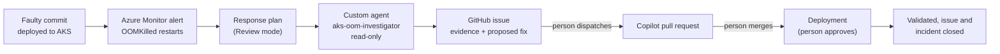

# Azure SRE Agent for automated incident response: configuration kit

This kit configures Azure SRE Agent to respond to an Azure Monitor alert on its own: it investigates
read-only, finds the change that caused the problem and proposes a fix. The fix then goes through code
review in GitHub, and a person approves every change that reaches the cluster.

The reference example is an AKS workload that is OOMKilled after a faulty commit. It was shown in the
CPF proof of concept (POC).

| Layer | What it creates | How |
|---|---|---|
| Alert rule | Azure Monitor log alert on repeated OOMKilled restarts | Terraform (`infra/`) |
| Agent configuration | 1 custom agent, 1 skill, 1 knowledge file (runbook), 1 response plan | Files in `agent-config/`, pushed by `scripts/Deploy-AgentConfig.ps1` |
| Guidance | Step-by-step setup and end-to-end walkthrough with screenshots | `docs/step-by-step-guide.md` |

## How the flow works



| Building block | What it is | In this kit |
|---|---|---|
| **Response plan** | Routes matching Azure Monitor incidents to a custom agent, in Review mode | `agent-config/response-plans/aks-web-oom-restarts.json` |
| **Custom agent** | The investigator: its instructions, read-only tools and allowed skill | `agent-config/custom-agents/aks-oom-investigator/` |
| **Skill** | The investigation procedure: evidence to collect, guardrails, proposal format | `agent-config/skills/aks-oom-investigation/` |
| **Knowledge** | The approved AKS OOM runbook the agent cites | `agent-config/knowledge/sre-agent-aks-oom-configuration.md` |
| **Code-change pipeline** | Ticket with the proposed fix, pull request, gated deployment | Your own pipelines. The POC used GitHub as an example; see [Using Azure DevOps instead of GitHub](#using-azure-devops-instead-of-github) |

## Prerequisites

| Item | Detail |
|---|---|
| An Azure SRE Agent | Create one with the Terraform in [../patch-management/infra](../patch-management/infra), or use an existing agent |
| Agent read access | **Reader** and **Azure Kubernetes Service RBAC Reader** on the AKS cluster, **Log Analytics Reader** on its workspace. With the patch-management Terraform, set `aks_cluster_ids` and `log_analytics_workspace_ids` |
| Incident platform | Azure Monitor connected as the agent's incident platform |
| Container insights | The cluster sends `KubePodInventory` to a Log Analytics workspace (the alert rule queries it) |
| Microsoft Teams (optional) | The Teams connector under **Connectors**. Without it, deploy with `-SkipMcpTools` |
| Your rights | **SRE Agent Administrator** on the agent; Azure CLI and PowerShell 7 |

## Quick start

```powershell
az login
az account set --subscription <subscription-id>

# 1. Create the alert rule
cd infra
Copy-Item terraform.tfvars.example terraform.tfvars   # then edit
terraform init
terraform apply
cd ..

# 2. Load the agent configuration
Copy-Item agent-config/parameters.example.json agent-config/parameters.json   # then edit

./scripts/Deploy-AgentConfig.ps1 -SubscriptionId <subscription-id> -ResourceGroup <agent-resource-group> -AgentName <agent-name> -WhatIf
./scripts/Deploy-AgentConfig.ps1 -SubscriptionId <subscription-id> -ResourceGroup <agent-resource-group> -AgentName <agent-name>
./scripts/Deploy-AgentConfig.ps1 -SubscriptionId <subscription-id> -ResourceGroup <agent-resource-group> -AgentName <agent-name> -VerifyOnly
```

Then connect Azure Monitor as the incident platform (guide, section 3). The deploy script loads only the items in this folder. It does not change the patch-management configuration on the
same agent.

## Repository layout

```text
infra/                                    Terraform: Azure Monitor alert rule on OOMKilled restarts
agent-config/
  parameters.example.json                 Values for {{TOKENS}}: cluster, namespace, alert rule, Teams channel
  custom-agents/aks-oom-investigator/     INSTRUCTIONS.md + agent.json (read-only tools, Teams MCP tools, allowed skill)
  skills/aks-oom-investigation/           SKILL.md + skill.json
  knowledge/                              Approved AKS OOM runbook
  response-plans/aks-web-oom-restarts.json  Alert filter, handling agent, Review mode
scripts/Deploy-AgentConfig.ps1            Pushes agent-config/ to the agent (-WhatIf, -VerifyOnly, -SkipMcpTools supported)
docs/step-by-step-guide.md                Setup and end-to-end walkthrough with screenshots
```

## Guardrails

- The custom agent has read-only Azure CLI tools. It cannot change the cluster.
- The response plan runs in **Review** mode. Keep it that way; Autonomous mode lets the agent run
  approval-level operations without asking.
- The fix is a code change: a person reviews and merges the pull request and approves the deployment.
- The ticket closes only after the deployment confirms recovery.

## Using Azure DevOps instead of GitHub

The POC used GitHub for the code-change half of the flow. The agent side does not depend on it. With Azure
DevOps the same pattern looks like this:

| In the POC (GitHub) | Azure DevOps equivalent |
|---|---|
| Handoff workflow opens a GitHub issue with the evidence and proposed fix | A pipeline (or the agent's Azure DevOps connector) creates a work item with the same content |
| Copilot coding agent opens a one-line pull request | An engineer, or a coding agent, raises a pull request in Azure Repos |
| Pull request review and merge | Branch policies: required reviewers and build validation |
| Protected `aks-demo` environment approval | Azure Pipelines environment with an approval check |
| Deployment workflow validates rollout and canaries, then closes the issue | Release stage runs the same checks, then resolves the work item |

Keep the same rules: the agent stays read-only, the fix is a reviewed code change, and a person approves
the deployment.
