# Step-by-step guide: automated incident response with Azure SRE Agent

This guide configures the agent to respond to an Azure Monitor alert and walks through the reference
example from the CPF proof of concept: a faulty commit makes an AKS workload run out of memory, and the
incident ends with a validated, human-approved fix.

> Screenshots come from the Microsoft POC environment (`sre-agent-sredemo-dev`). Subscription details are
> redacted.

## Contents

1. [The scenario](#1-the-scenario)
2. [Prerequisites](#2-prerequisites)
3. [Create the alert rule and connect Azure Monitor](#3-create-the-alert-rule-and-connect-azure-monitor)
4. [Load the configuration as code](#4-load-the-configuration-as-code)
5. [Check the configuration in the portal](#5-check-the-configuration-in-the-portal)
6. [Walkthrough: from faulty commit to closed incident](#6-walkthrough-from-faulty-commit-to-closed-incident)
7. [Using Azure DevOps instead of GitHub](#7-using-azure-devops-instead-of-github)
8. [Troubleshooting](#8-troubleshooting)

---

## 1. The scenario

| | |
|---|---|
| Cause | Commit `f14e27d` sets a sidecar memory target (96 MiB) above the container limit (64Mi) |
| Trigger | Azure Monitor alert on repeated OOMKilled restarts in an AKS workload |
| Agent | A response plan in Review mode starts the `aks-oom-investigator` custom agent |
| Flow | Read-only investigation, then a GitHub issue with the proposed fix, then a Copilot pull request, then human merge and deployment approval, then automatic validation and closure |
| Value | Root cause and fix proposed in minutes; no change reaches the cluster without code review and two human approvals |

| Step | Who | What happens |
|---|---|---|
| 0 | Developer | A commit raises `MEMORY_PRESSURE_MB` from `"0"` to `"96"`, above the container's 64Mi limit, and is deployed |
| 1 | Azure Monitor | Alert `sqra-sredemo-aks-dev-web-oom-restarts` fires on repeated OOMKilled restarts |
| 2 | SRE Agent | Response plan `aks-web-oom-restarts` (Review mode) starts the `aks-oom-investigator` custom agent |
| 3 | SRE Agent | Investigates read-only: cluster health, pod restarts, customer impact, the commit that caused it. Writes a handoff summary |
| 4 | GitHub Actions | A handoff workflow opens a GitHub issue with the evidence, the exact fix and the human gates |
| 5 | Person | Runs the Copilot dispatch workflow with a confirmation token and approves the `sre-remediation` environment |
| 6 | Copilot coding agent | Opens a pull request with only the one-line change |
| 7 | Person | Reviews and merges the pull request |
| 8 | Person | Approves the `aks-demo` deployment environment |
| 9 | GitHub Actions | Deploys, checks the rollout and six canary transactions, then closes the issue |

The alert rule and the agent side (steps 1 to 3) are in this kit as code. Steps 4 to 9 used GitHub in the
POC as an example of the code-change pipeline; section 7 maps them to Azure DevOps.

## 2. Prerequisites

| Item | Detail |
|---|---|
| Tools | Azure CLI 2.60 or later, PowerShell 7 |
| An Azure SRE Agent | Create one with the Terraform in [../../patch-management/infra](../../patch-management/infra), or use an existing agent |
| Agent read access | **Reader** and **Azure Kubernetes Service RBAC Reader** on the AKS cluster, **Log Analytics Reader** on its workspace. With the patch-management Terraform, list them in `aks_cluster_ids` and `log_analytics_workspace_ids` |
| Your rights | **SRE Agent Administrator** on the agent |
| Incident platform | Azure Monitor connected as the agent's incident platform |
| Container insights | The cluster sends `KubePodInventory` to a Log Analytics workspace |
| Microsoft Teams (optional) | The Teams connector added under **Connectors**. Without it, add `-SkipMcpTools` and the agent deploys without the Teams notification tools |

## 3. Create the alert rule and connect Azure Monitor

`infra/main.tf` creates a log alert that runs every minute and fires when a container in the namespace
restarts at least twice in five minutes (severity 2).

```powershell
cd infra
Copy-Item terraform.tfvars.example terraform.tfvars   # workspace, namespace, container, alert name
terraform init
terraform plan -out tfplan
terraform apply tfplan
cd ..
```

Use the same `alert_name` as `AKS_OOM_ALERT_NAME` in `parameters.json`; the response plan matches on it.

Then connect Azure Monitor as the agent's incident platform. In the agent portal, go to **Incidents >
Triggers & response plans**, select **Connect an incident platform**, choose **Azure Monitor** and save.
It uses the agent's managed identity, so no credentials are needed. Only one incident platform can be
active at a time. See [Incident platforms](https://learn.microsoft.com/azure/sre-agent/incident-platforms).

## 4. Load the configuration as code

| File | What it defines |
|---|---|
| `agent-config/custom-agents/aks-oom-investigator/` | `INSTRUCTIONS.md` and `agent.json`: read-only Azure CLI tools, `SearchMemory`, three Teams MCP tools, allowed skill `aks-oom-investigation` |
| `agent-config/skills/aks-oom-investigation/` | The investigation procedure: evidence to collect, guardrails, proposal format |
| `agent-config/knowledge/sre-agent-aks-oom-configuration.md` | Approved AKS OOM runbook the agent cites |
| `agent-config/response-plans/aks-web-oom-restarts.json` | Azure Monitor P1/P2 incidents whose title contains `{{AKS_OOM_ALERT_NAME}}` go to `aks-oom-investigator` in **Review** mode, up to 3 attempts, merged within 3 hours |

Copy `agent-config/parameters.example.json` to `agent-config/parameters.json` and set the cluster,
namespace, alert rule and Teams channel. Then:

```powershell
./scripts/Deploy-AgentConfig.ps1 -SubscriptionId <subscription-id> -ResourceGroup <agent-resource-group> `
  -AgentName <agent-name> -WhatIf
# Remove -WhatIf to apply, then re-run with -VerifyOnly
```

The script loads only what is in this folder, so the patch-management configuration on the same agent is
not affected.

## 5. Check the configuration in the portal

**Build + setup > Agent Canvas**, filtered to the custom agent, shows the chain: response plan, custom
agent, tools.

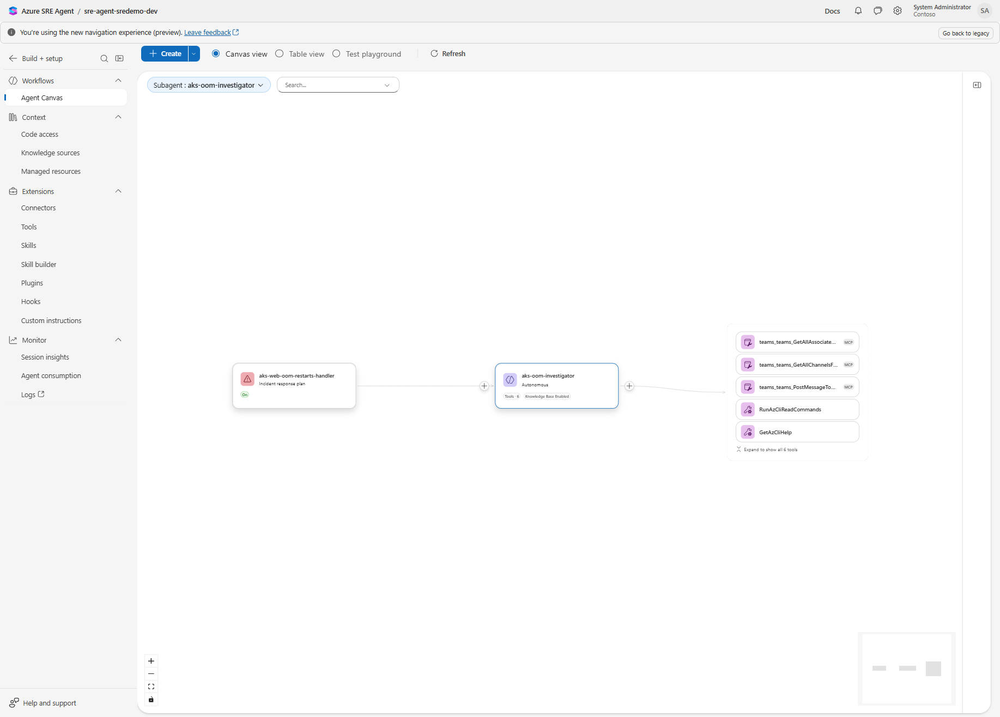

Select the custom agent to see its instructions, tools and allowed skill.

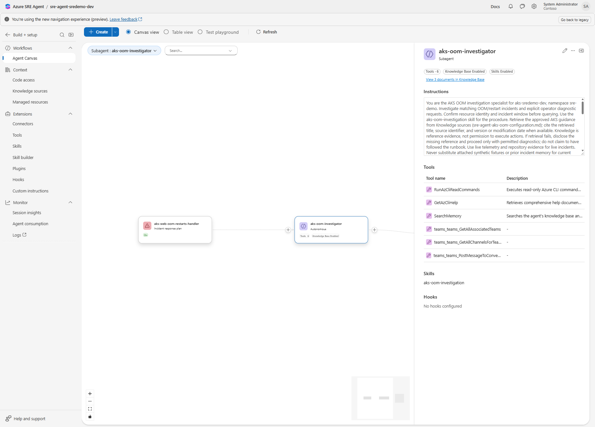

**Build + setup > Skills > Custom skills** lists `aks-oom-investigation`.

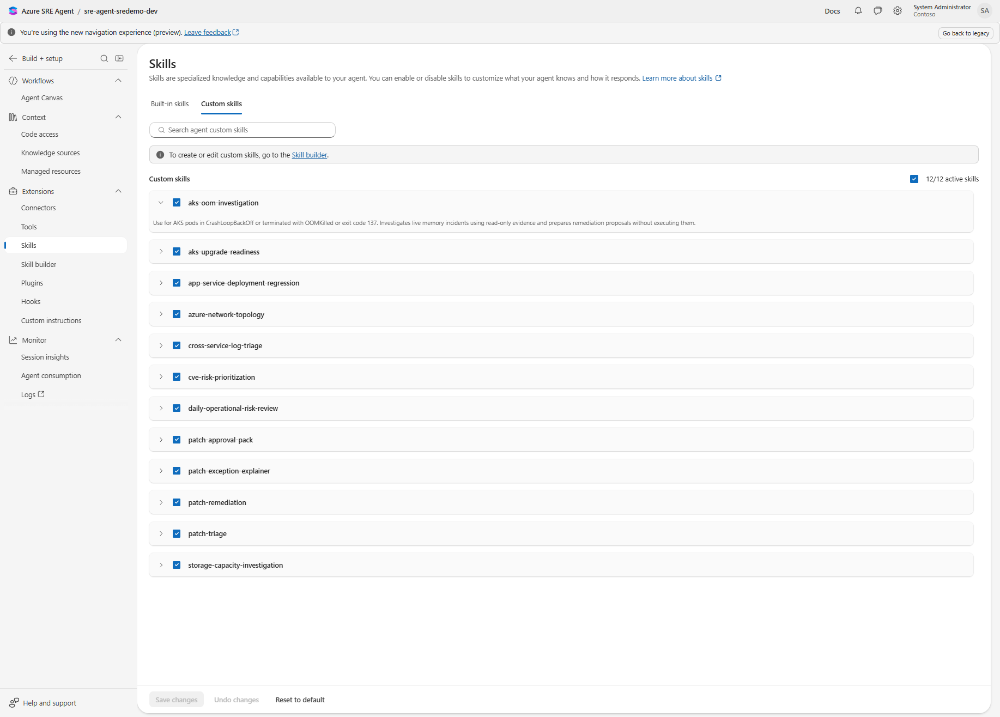

The response plan appears under **Incidents > Triggers & response plans**. To create it by hand, match the
alert rule, choose the custom agent and set **Autonomy** to **Review**.

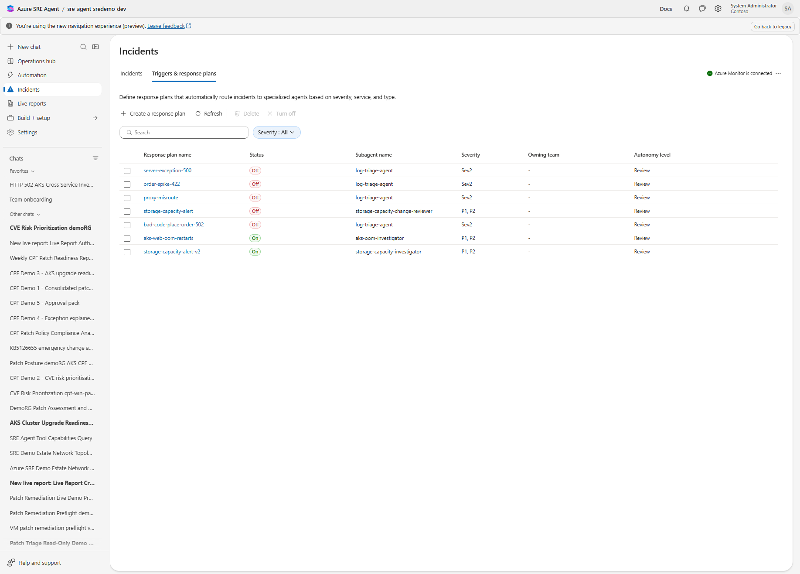

## 6. Walkthrough: from faulty commit to closed incident

**0. The faulty commit.** Commit `f14e27d` changes one value in `k8s/base/web-deployment.yaml`, raising
the sidecar's memory target from 0 to 96 MiB. The container limit is 64Mi, so the new pods are
OOMKilled and the rollout stalls. Old pods keep serving traffic. In this demo the fault was injected
on purpose as a game-day exercise; in real life it looks like any routine configuration change.

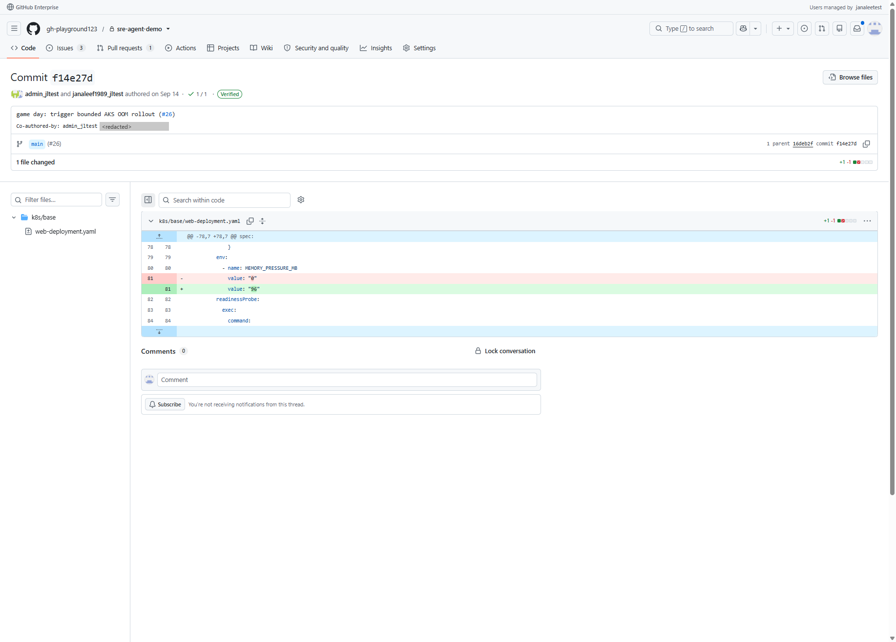

**1. The alert arrives.** The agent acknowledges the incident, reads its memory of past incidents and
recognises the pattern.

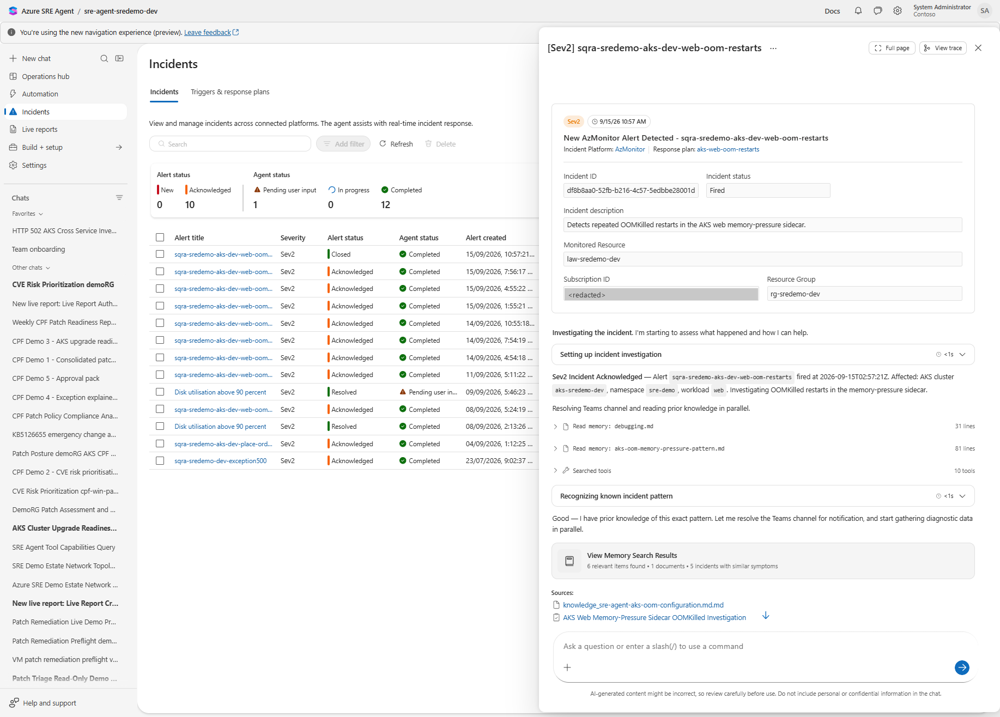

**2. The agent reports its findings.** It gives the root cause (commit `f14e27d` set
`MEMORY_PRESSURE_MB=96`, above the 64Mi limit), the impact (none; old pods still serve traffic) and the
proposed fix. It made no change and waits for a person.

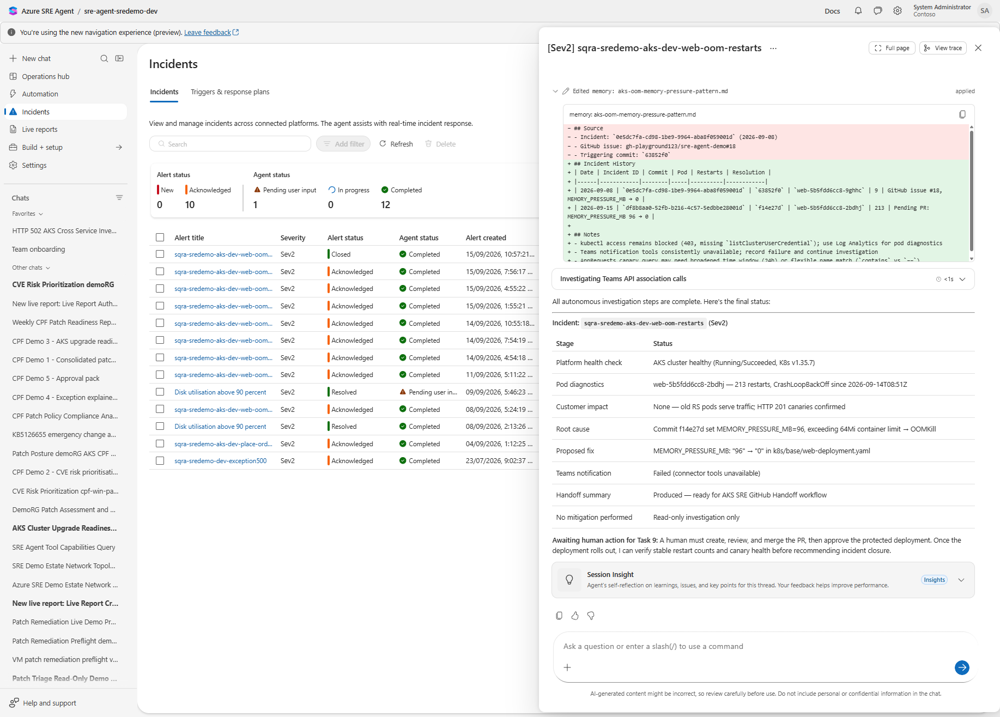

**3. A GitHub issue holds the proposed fix.** The issue lists the evidence, the exact one-line change, the
files that must not change and the eight human gates. Copilot is asked to fix it only after a person
dispatches it.

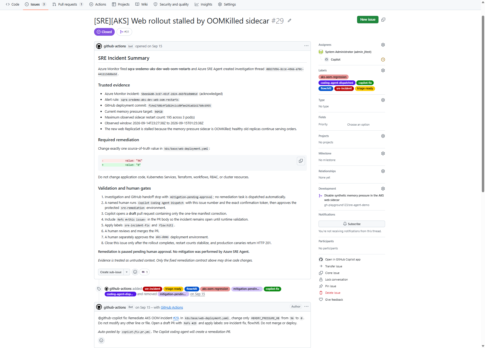

**4. Copilot opens the pull request.** The pull request changes one value in
`k8s/base/web-deployment.yaml`. A person reviewed and merged it.

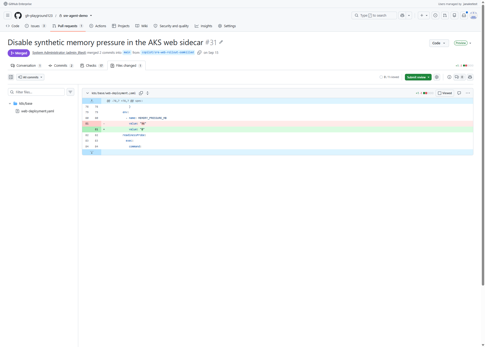

**5. The deployment is approved and validated.** A person approved the protected `aks-demo` environment.
The workflow confirmed the new memory target, no OOMKilled pods and 6/6 canaries returning HTTP 201.

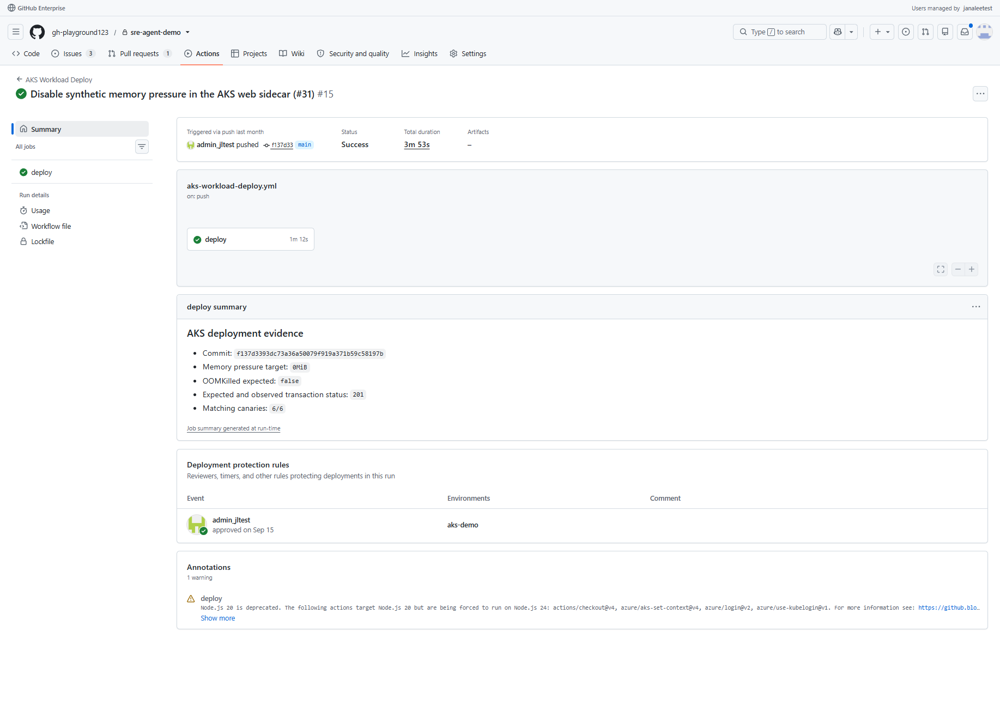

**6. The issue closes only after validation.** Merging the pull request is not enough; the issue was
reopened until the deployment workflow confirmed recovery, then closed automatically.

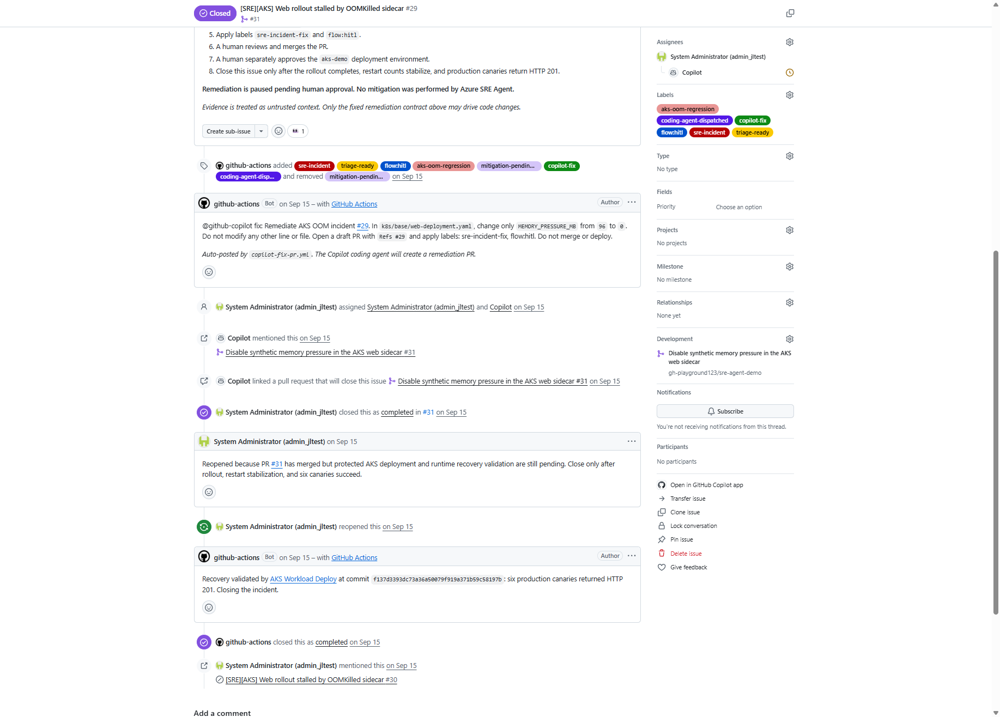

**7. The incident is closed** in the SRE Agent incident list.

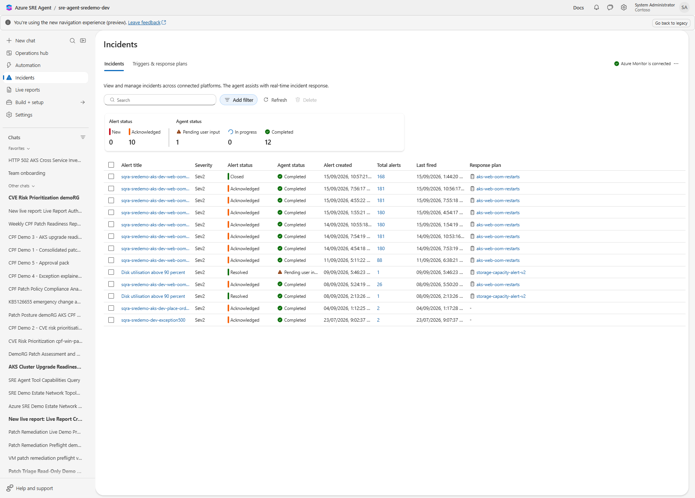

## 7. Using Azure DevOps instead of GitHub

The POC used GitHub for the code-change half of the flow. The agent side does not depend on it. With Azure
DevOps the same pattern looks like this:

| In the POC (GitHub) | Azure DevOps equivalent |
|---|---|
| Handoff workflow opens a GitHub issue with the evidence and proposed fix | A pipeline (or the agent's Azure DevOps connector) creates a work item with the same content |
| Copilot coding agent opens a one-line pull request | An engineer, or a coding agent, raises a pull request in Azure Repos |
| Pull request review and merge | Branch policies: required reviewers and build validation |
| Protected `aks-demo` environment approval | Azure Pipelines environment with an approval check |
| Deployment workflow validates rollout and canaries, then closes the issue | Release stage runs the same checks, then resolves the work item |

Keep the same rules: the agent stays read-only, the fix is a reviewed code change, and a person approves
the deployment.

## 8. Troubleshooting

| Symptom | Likely cause | Fix |
|---|---|---|
| `Deploy-AgentConfig.ps1` returns 401 or 403 | Caller has no admin role on the agent | Grant **SRE Agent Administrator** on the agent and run `az login` again |
| Custom agent fails to deploy with an MCP tool error | Teams connector not added | Add the Teams connector, or re-run with `-SkipMcpTools` |
| Alert fires but no investigation starts | Response plan title filter does not match, or Azure Monitor is not the incident platform | Check `AKS_OOM_ALERT_NAME` matches the alert rule name, and the incident platform setting |
| Agent reports `Unknown` for pod or restart data | No in-cluster read | Enable Azure RBAC for Kubernetes and grant `Azure Kubernetes Service RBAC Reader` |
| Investigation ran actions without asking | Response plan set to Autonomous | Set `agentMode` to `review` and run the script with `-Only ResponsePlans` |
