# Azure SRE Agent for patch management: configuration kit

This kit rebuilds the patch-management agent from the CPF proof of concept (POC). Everything the agent
needs is kept as code, so you can review it, version it and redeploy it into any subscription.

| Layer | What it creates | How |
|---|---|---|
| Azure resources | SRE Agent, managed identity, Application Insights, least-privilege role assignments, optional sandbox VM | Terraform (`infra/`) |
| Agent configuration | 6 skills, 2 custom agents, 1 knowledge file, 5 common prompts, 1 scheduled task | Files in `agent-config/`, pushed by `scripts/Deploy-AgentConfig.ps1` |
| Guidance | Step-by-step setup with screenshots, use-case catalogue | `docs/` |

> **Read-only by default.** The agent finds, ranks, explains and documents patch risk. Update Manager and
> AKS do the installing, after a human approves. Gated remediation on a pilot VM is optional and off unless
> you turn it on (`enable_patch_write` in Terraform and `-IncludeWriteSkills` in the deploy script).

## Where to start

| If you want to... | Read |
|---|---|
| Understand what the agent does and why | [docs/use-cases.md](docs/use-cases.md) |
| Build it step by step, with screenshots | [docs/step-by-step-guide.md](docs/step-by-step-guide.md) |
| Deploy it quickly | [Quick start](#quick-start) below |
| Add automated incident response to the same agent | [../automated-incident-response](../automated-incident-response/README.md) |

## How the pieces fit

| Building block | What it is | In this kit |
|---|---|---|
| **Agent** | The Azure SRE Agent resource, with a managed identity and a permission level | `infra/main.tf` |
| **Role assignments** | What the agent can see (and, optionally, change) in Azure | `infra/rbac.tf` |
| **Skill** | Reusable instructions for one task: which sources to query, guardrails, output format | `agent-config/skills/` |
| **Custom agent** | A specialist with its own instructions, tool list and allowed skills; the main agent hands work to it | `agent-config/custom-agents/` |
| **Knowledge** | Documents the agent checks against, here the patch policy and exception register | `agent-config/knowledge/` |
| **Common prompt** | A saved question that users pick from the chat with `/` | `agent-config/prompts/` |
| **Scheduled task** | A prompt that runs on a schedule and posts a new thread each time | `agent-config/scheduled-tasks/` |

## Architecture

```mermaid
flowchart LR
  subgraph Sources["Read-only evidence sources"]
    UM["Azure Update Manager<br/>(VMs + Arc servers)"]
    ARG["Azure Resource Graph"]
    AKS["AKS upgrade profile<br/>+ in-cluster read"]
    DEF["Defender for Cloud<br/>vulnerabilities"]
    LAW["Log Analytics<br/>(Change Tracking)"]
    EXT["Public CVE feeds<br/>MSRC, FIRST EPSS, CISA KEV"]
  end

  subgraph Agent["Azure SRE Agent (Review mode)"]
    SK["Skills<br/>triage, AKS readiness, CVE risk,<br/>exception explainer, approval pack"]
    KN["Knowledge<br/>patch policy + exception register"]
    PR["Common prompts"]
    ST["Weekly scheduled task"]
  end

  Sources -->|Reader roles| Agent
  Agent --> OUT["Cited reports and evidence packs"]
  OUT --> CAB["Human / change board approval"]
  CAB --> EXEC["Update Manager or AKS upgrade<br/>(existing tooling)"]
  EXEC -->|verify| Agent
```



## Quick start

Prerequisites: Terraform 1.6 or later, Azure CLI, PowerShell 7, and Owner (or Contributor plus User Access
Administrator) on the subscription. The person running the scripts also needs a role on the agent, such as
**SRE Agent Administrator**, to load the configuration.

```powershell
# 1. Sign in
az login
az account set --subscription <subscription-id>

# 2. Create the agent and role assignments
cd infra
Copy-Item terraform.tfvars.example terraform.tfvars   # then edit the scopes
terraform init
terraform plan -out tfplan
terraform apply tfplan

# 3. Fill in the configuration parameters
cd ..
Copy-Item agent-config/parameters.example.json agent-config/parameters.json   # then edit

# 4. Preview, load and verify the agent configuration
./scripts/Deploy-AgentConfig.ps1 -SubscriptionId <subscription-id> -ResourceGroup rg-sre-agent-patch -AgentName sre-agent-patch -WhatIf
./scripts/Deploy-AgentConfig.ps1 -SubscriptionId <subscription-id> -ResourceGroup rg-sre-agent-patch -AgentName sre-agent-patch
./scripts/Deploy-AgentConfig.ps1 -SubscriptionId <subscription-id> -ResourceGroup rg-sre-agent-patch -AgentName sre-agent-patch -VerifyOnly
```

To do steps 2 and 4 in one go, set `apply_agent_config = true` in `terraform.tfvars`. Terraform then runs
the script after it creates the agent, and again whenever a file in `agent-config/` changes.

Then open the `portal_url` output and run the five common prompts. The full walkthrough, with screenshots,
is in [docs/step-by-step-guide.md](docs/step-by-step-guide.md).

## Repository layout

```text
infra/                         Terraform: agent, identity, telemetry, RBAC, optional sandbox VM
  main.tf                      Microsoft.App/agents resource (azapi) + optional config hook
  rbac.tf                      Read roles; optional write role behind enable_patch_write
  demo-vm.tf                   Optional Windows Server VM with manual patching
agent-config/
  parameters.example.json      Values for {{TOKENS}} used in the files below
  skills/<name>/SKILL.md       Skill instructions (what the agent does, guardrails, output format)
  skills/<name>/skill.json     Description and readOnly flag
  custom-agents/<name>/        Custom agents: INSTRUCTIONS.md + agent.json (tools, allowed skills, readOnly)
  knowledge/*.md               Patch policy and exception register
  prompts/*.md                 Common prompts that appear in the portal's prompt picker
  scheduled-tasks/*.json       Cron schedule, mode and prompt for recurring reports
scripts/Deploy-AgentConfig.ps1 Pushes agent-config/ to the agent (-WhatIf and -VerifyOnly supported)
docs/                          Setup guide, use cases, screenshots
```

## What's configured

| Use case | Skill | Common prompt | Access |
|---|---|---|---|
| One consolidated, cited patch posture across VMs, Arc servers and AKS | `patch-triage` | `cpf-patch-1-consolidated-view` | Read |
| AKS control-plane and node-image upgrade readiness | `aks-upgrade-readiness` | `cpf-patch-2-aks-readiness` | Read |
| Explain why a machine is non-compliant or excepted | `patch-exception-explainer` | `cpf-patch-3-explain-exception` | Read |
| Change-approval evidence pack | `patch-approval-pack` | `cpf-patch-4-approval-pack` | Read |
| Which KB fixes which CVE, ranked by real-world risk, with charts | `cve-risk-prioritization` | `cpf-patch-5-cve-risk` | Read |
| Weekly readiness report | `patch-triage` + `aks-upgrade-readiness` | Scheduled task `weekly-patch-readiness-report` | Read |
| Install approved updates on one pilot VM, with gates | `patch-remediation` | None; ask explicitly | Write (optional) |

### Custom agents

| Custom agent | Tools | Allowed skills | Access |
|---|---|---|---|
| `patch-triage-agent` | Azure CLI **read** only | `patch-triage`, `cve-risk-prioritization`, `aks-upgrade-readiness`, `patch-exception-explainer`, `patch-approval-pack` | Read |
| `patch-remediation-agent` | Azure CLI read + **write** | `patch-remediation` (one named pilot VM, explicit approval, no reboot) | Write (optional) |

The main agent hands off to these specialists. Separating them means the read-only agent can never run a
write command, and the write agent is only loaded when you add `-IncludeWriteSkills`.

Details, sample questions and example outputs are in [docs/use-cases.md](docs/use-cases.md).

## Before you go live

1. **Replace the policy.** `agent-config/knowledge/cpf-patch-policy-demo.md` holds **synthetic** service
   levels, maintenance windows and an exception register. Replace them with your approved policy before
   relying on any SLA verdict.
2. **Keep Review mode.** The agent uses `action_mode = "Review"` and the scheduled task uses `agentMode:
   review`. Autonomous mode lets the agent run approval-level operations without asking.
3. **Allow outbound access to CVE feeds.** CVE enrichment calls `api.msrc.microsoft.com`,
   `api.first.org` (EPSS) and `www.cisa.gov` (KEV). If they are blocked, the agent reports those fields as
   `Unknown`.
4. **Grant in-cluster read for AKS.** Deprecated-API and pod disruption budget checks need `Azure Kubernetes
   Service RBAC Reader` (granted by `rbac.tf`) on clusters with Azure RBAC for Kubernetes enabled.
   Otherwise they report `Unknown`.
5. **Onboard on-premises servers to Azure Arc** and enable periodic assessment in Update Manager, so they
   appear in the same report.

## Cleanup

```powershell
cd infra
terraform destroy
```
