# Step-by-step guide: configure Azure SRE Agent for patch management

This guide rebuilds the patch-management agent used in the CPF proof of concept. Every step has an
infrastructure-as-code path (Terraform plus `scripts/Deploy-AgentConfig.ps1`) and the equivalent in the
portal, with screenshots from the POC agent.

> Screenshots come from the Microsoft POC environment (`sre-agent-sredemo-dev`). Subscription details are
> redacted. The policy values shown are **synthetic** demo values.

## Contents

1. [Prerequisites](#1-prerequisites)
2. [Create the agent and its access (Terraform)](#2-create-the-agent-and-its-access-terraform)
3. [Check the agent settings](#3-check-the-agent-settings)
4. [Load skills, knowledge, prompts and the scheduled task](#4-load-skills-knowledge-prompts-and-the-scheduled-task)
5. [Skills and custom agents](#5-skills-and-custom-agents)
6. [Knowledge: patch policy and exception register](#6-knowledge-patch-policy-and-exception-register)
7. [Managed resources and connectors](#7-managed-resources-and-connectors)
8. [Weekly scheduled task](#8-weekly-scheduled-task)
9. [Run the use cases](#9-run-the-use-cases)
10. [Patch through infrastructure as code](#10-patch-through-infrastructure-as-code)
11. [Troubleshooting](#11-troubleshooting)

---

## 1. Prerequisites

| Item | Detail |
|---|---|
| Tools | Terraform 1.6 or later, Azure CLI 2.60 or later, PowerShell 7 |
| Deployer rights | Owner, or Contributor plus User Access Administrator, on the subscription or the resource groups in scope |
| Agent rights | **SRE Agent Administrator** on the agent for whoever runs `Deploy-AgentConfig.ps1`. Terraform grants `agent_user_role_name` (default **SRE Agent Standard User**) to `agent_user_principal_ids`; set it to `SRE Agent Administrator` for the deployer. |
| Region | A region where Azure SRE Agent is available. The POC used Southeast Asia. |
| Evidence sources | Azure Update Manager periodic assessment enabled on the VMs and Arc servers in scope; Defender for Servers recommended; AKS clusters in scope |
| Outbound access | `api.msrc.microsoft.com`, `api.first.org`, `www.cisa.gov` for CVE enrichment (optional; the agent reports `Unknown` if they are blocked) |

## 2. Create the agent and its access (Terraform)

```powershell
az login
az account set --subscription <subscription-id>

cd infra
Copy-Item terraform.tfvars.example terraform.tfvars
```

Edit `terraform.tfvars`. The main settings are:

| Variable | Purpose | POC value |
|---|---|---|
| `agent_name`, `agent_resource_group_name`, `location` | Agent identity and placement | Example: `sre-agent-patch` in `rg-sre-agent-patch`, Southeast Asia |
| `action_mode` | `Review` means the agent proposes and a human approves every action | `Review` |
| `vm_scope_ids` | Resource groups holding VMs and Arc servers (Reader) | VM resource group |
| `aks_cluster_ids` | Clusters to assess (Reader + AKS RBAC Reader) | 1 AKS cluster |
| `log_analytics_workspace_ids` | Workspaces with Update Manager or Change Tracking data (Log Analytics Reader) | 1 workspace |
| `grant_security_reader` | Lets the agent read Defender for Cloud findings | `true` |
| `enable_patch_write` | Optional remediation. Grants Virtual Machine Contributor on `patch_write_scope_ids` | `false` |
| `agent_user_principal_ids`, `agent_user_role_name` | People who use or configure the agent, and the role they get | operators |
| `deploy_demo_vm` | Optional Windows Server sandbox VM with manual patch mode, for a safe demo | `true` in the POC |
| `apply_agent_config` | Runs the deploy script automatically after `apply` | optional |

```powershell
terraform init
terraform plan -out tfplan
terraform apply tfplan
terraform output portal_url
```

What Terraform creates:

- the SRE Agent (`Microsoft.App/agents`, through the `azapi` provider) in Review mode;
- a user-assigned managed identity, Log Analytics workspace and Application Insights;
- **read-only** role assignments: Reader, Azure Kubernetes Service RBAC Reader, Log Analytics Reader,
  Monitoring Reader and Security Reader;
- the optional sandbox VM.

Open `portal_url`. You should see the agent home page.

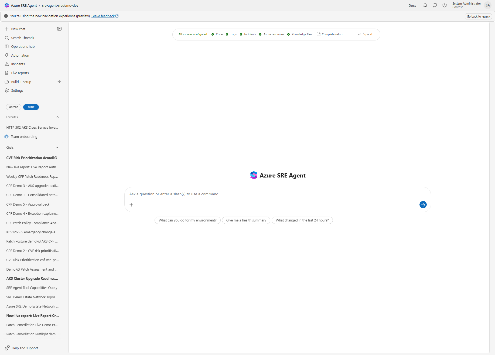

## 3. Check the agent settings

In the portal, go to **Settings > General**. Check that:

- **Agent permissions level** is **Reader**;
- **Agent mode** is **Review**;
- the managed identity and Application Insights names match the Terraform outputs.

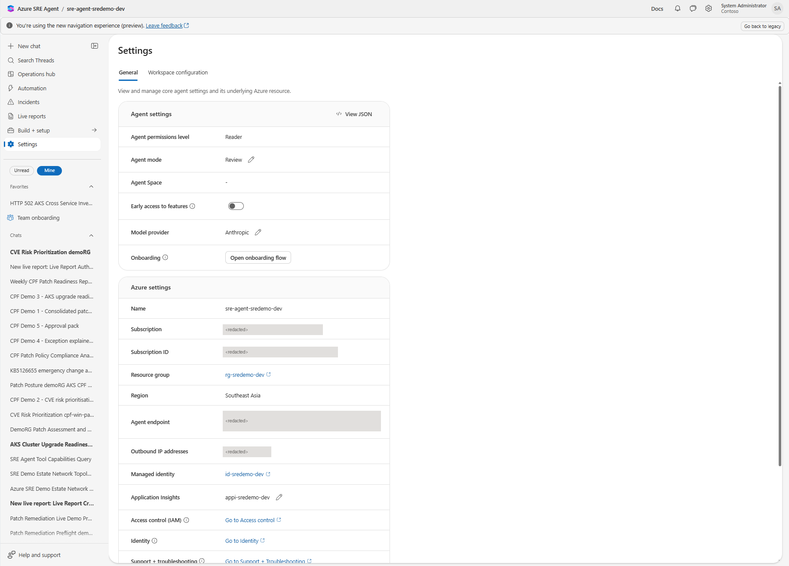

> Keep **Review** mode, especially if you turn on optional remediation. In Review mode the agent asks a human before it runs
> anything that changes a resource.

## 4. Load skills, knowledge, prompts and the scheduled task

All agent configuration (skills, custom agents, knowledge, prompts and the scheduled task) lives in
`agent-config/` as plain files. `{{TOKENS}}` such as
`{{VM_RESOURCE_GROUP}}` are replaced from a parameters file, so the same files work in any environment.

```powershell
cd ..
Copy-Item agent-config/parameters.example.json agent-config/parameters.json
# Edit parameters.json: subscription, resource groups, AKS cluster, pilot and exception VM names, policy title

$p = @{ SubscriptionId = '<subscription-id>'; ResourceGroup = 'rg-sre-agent-patch'; AgentName = 'sre-agent-patch' }

./scripts/Deploy-AgentConfig.ps1 @p -WhatIf       # preview: shows what would be created or updated
./scripts/Deploy-AgentConfig.ps1 @p               # load
./scripts/Deploy-AgentConfig.ps1 @p -VerifyOnly   # read back and confirm every item exists
```

| Switch | Effect |
|---|---|
| `-WhatIf` | Prints the planned changes and makes none |
| `-VerifyOnly` | Reads the agent and reports anything missing or different |
| `-IncludeWriteSkills` | Also loads the write-access items (`patch-remediation` skill and `patch-remediation-agent`). Leave off for read-only use. |
| `-ReplaceScheduledTasks` | Deletes and recreates scheduled tasks with the same name |
| `-Only` | Applies only the listed item types: `Skills`, `CustomAgents`, `Knowledge`, `Prompts`, `ScheduledTasks`. For example, `-Only ScheduledTasks -ReplaceScheduledTasks` resets the weekly task to Review mode without touching anything else. |

The script is idempotent. Run it again whenever a file in `agent-config/` changes, or let Terraform run it
by setting `apply_agent_config = true`.

The following sections show what each item looks like in the portal, and how to create it by hand if you
prefer.

## 5. Skills and custom agents

Skills tell the agent **how** to do a task: which sources to query, what guardrails to follow and what the
output looks like. Each skill is a folder in `agent-config/skills/` with a `SKILL.md` (instructions) and a
`skill.json` (description and `readOnly` flag).

| Skill | Access | What it does |
|---|---|---|
| `patch-triage` | Read | Consolidated patch posture across VMs, Arc servers and AKS, compared with policy |
| `cve-risk-prioritization` | Read | Maps KB to CVE, adds CVSS, EPSS, CISA KEV and exposure, and ranks by real risk |
| `aks-upgrade-readiness` | Read | Control-plane and node-image readiness, blockers and conditions |
| `patch-exception-explainer` | Read | Explains why a machine is non-compliant or excepted, with evidence |
| `patch-approval-pack` | Read | Builds a change-approval evidence pack. Never approves or executes. |
| `patch-remediation` | Write (optional) | Installs approved updates on a pilot VM, with pre-checks and verification |

**Portal path:** **Build + setup > Skill builder** (create) or **Build + setup > Skills** (manage).


The custom skills list after loading:

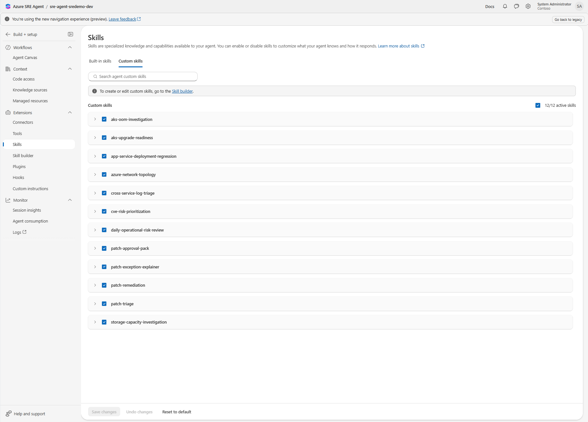

Open a skill to see its description and instructions:

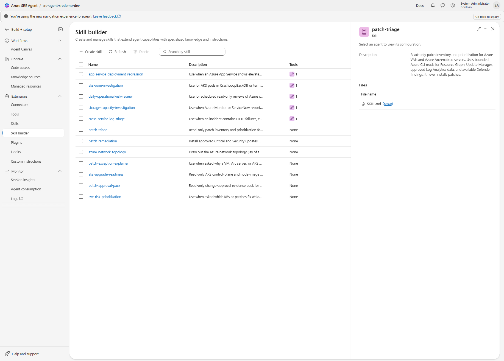

To create a skill by hand, select **Create skill**, give it the folder name, paste the description from
`skill.json`, and paste the body of `SKILL.md` into the editor.

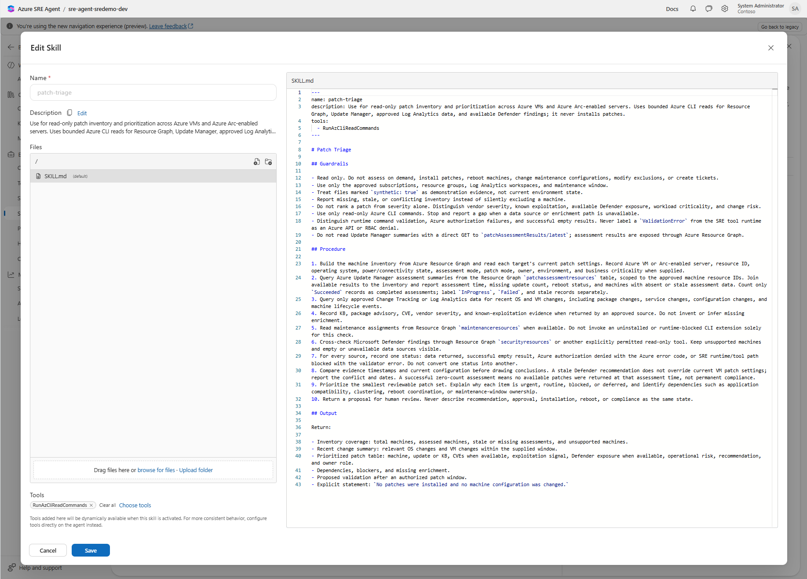

### Custom agents

Custom agents are specialists the main agent hands work to. Each has its own instructions, tool list and
allowed skills. They live in `agent-config/custom-agents/<name>/` as `INSTRUCTIONS.md` plus `agent.json`.

| Custom agent | Access | Tools | Purpose |
|---|---|---|---|
| `patch-triage-agent` | Read | `RunAzCliReadCommands` | Read-only inventory, coverage and prioritisation. Ends every answer with "No patches were installed". |
| `patch-remediation-agent` | Write (optional) | `RunAzCliReadCommands`, `RunAzCliWriteCommands` | Installs approved Critical and Security updates on one named pilot VM, after every preflight gate and explicit approval |

**Portal path:** **Build + setup > Workflows > Agent Canvas**, then add a custom agent. Paste
`INSTRUCTIONS.md`, select the tools listed in `agent.json`, and allow the listed skills. The deploy script does this through
`PUT /api/v2/extendedAgent/agents/{name}`.

> Load skills before custom agents, because each agent refers to its skills by name. The deploy script does
> this in the right order.

## 6. Knowledge: patch policy and exception register

The agent compares what it finds against **your** policy. `agent-config/knowledge/cpf-patch-policy-demo.md`
contains:

- patch SLAs by classification (for example Critical, Security, known-exploited);
- maintenance windows;
- reboot and approval rules;
- an exception register (machine, reason, owner, expiry).

> These values are **synthetic**. Replace them with your approved policy before you rely on any SLA
> verdict.

**Portal path:** **Build + setup > Knowledge sources > Add > Upload file**.

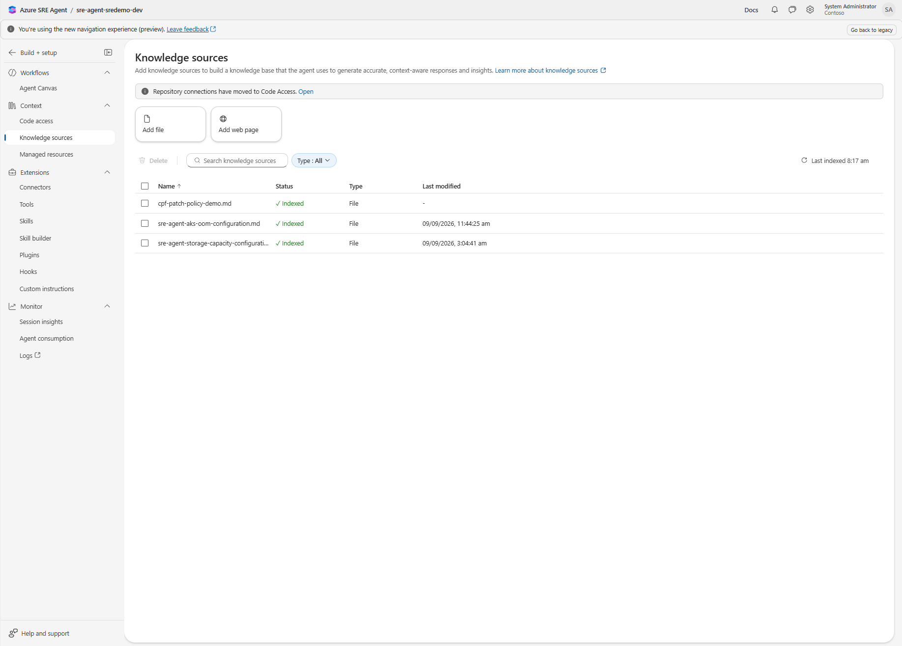

## 7. Managed resources and connectors

**Managed resources** are the scopes the agent can see. Terraform grants the roles. The portal shows the
result under **Build + setup > Managed resources**.

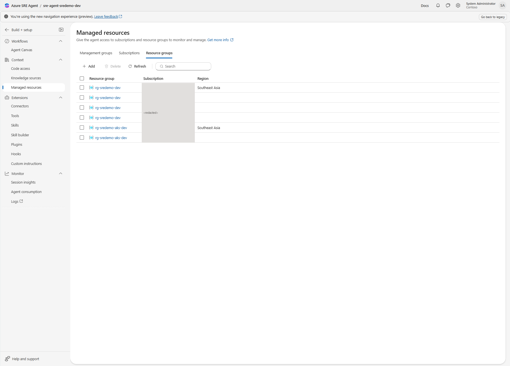

**Connectors** add data sources such as Log Analytics, Application Insights or an ITSM tool. This kit only
needs Azure Monitor. You can add ServiceNow or Azure DevOps connectors later to raise change records.

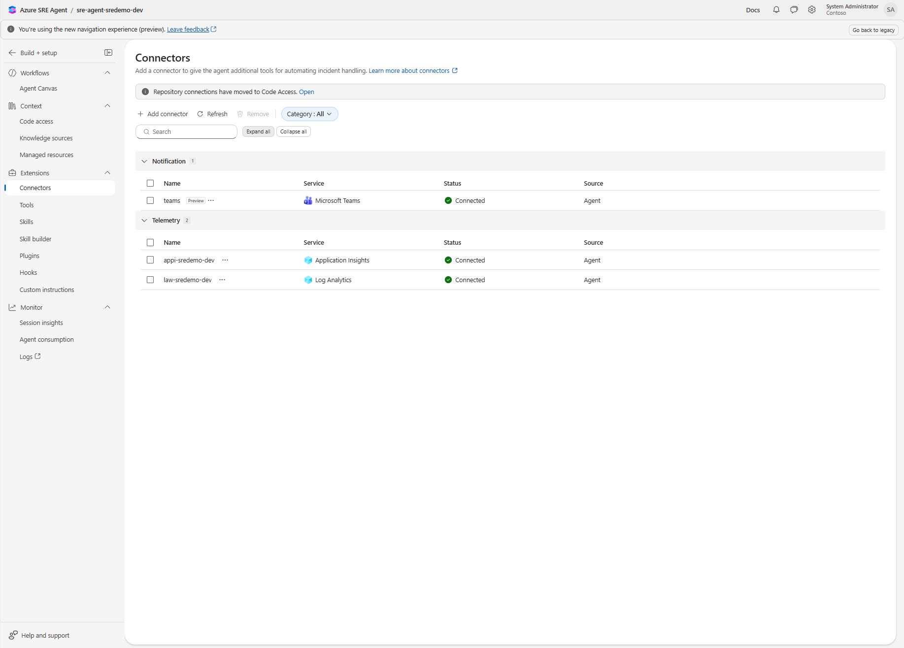

## 8. Weekly scheduled task

`agent-config/scheduled-tasks/weekly-patch-readiness-report.json` defines a read-only report every Monday at
09:00 SGT (`0 1 * * 1` UTC). It covers coverage, SLA breaches, AKS readiness, the top exceptions and any
missing data sources.

**Portal path:** **Automation > Scheduled tasks**.

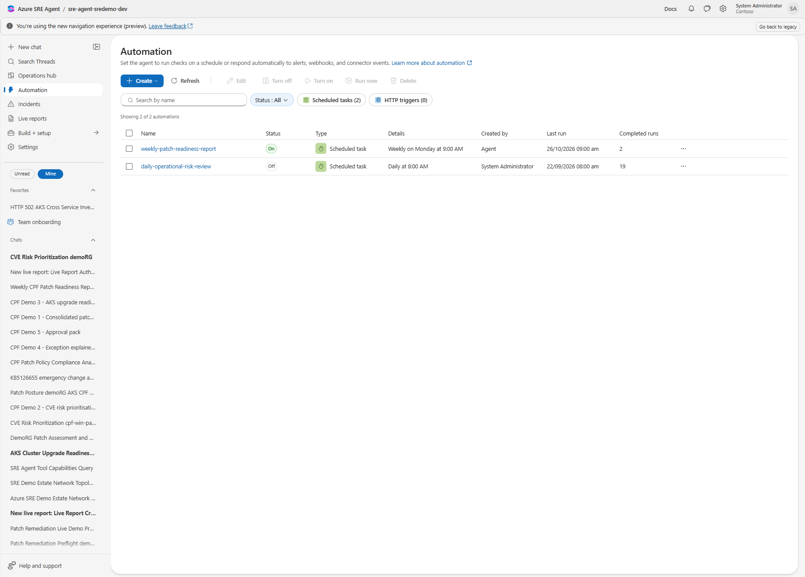

Each run creates a new thread, which gives you an audit trail:

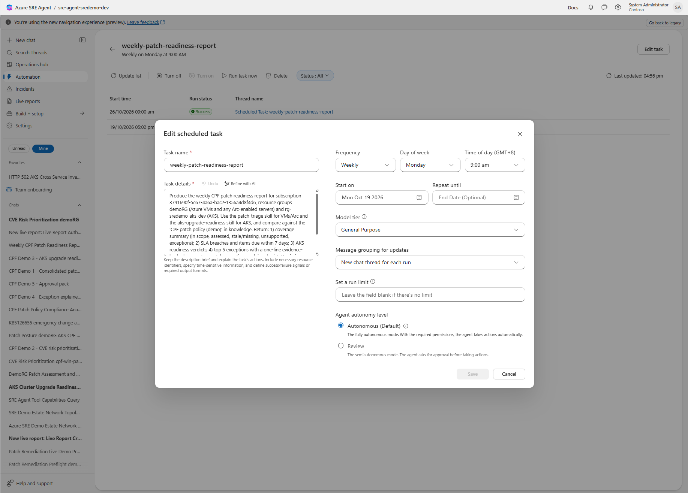

Task configuration (prompt, schedule, model tier and autonomy):


> **Set autonomy to Review.** The POC task in the screenshot was created from chat and defaulted to
> **Autonomous**. The kit's JSON sets `agentMode: review`. If you create the task in the portal, change
> **Autonomy** to **Review** before saving.

## 9. Run the use cases

The six common prompts appear in the chat prompt picker. Type `/` in a new chat, or paste the prompt from
`agent-config/prompts/`. Every prompt ends with "Read only" or "Do not approve or execute".

| # | Prompt file | Screenshot |
|---|---|---|
| 1 | `patch-1-consolidated-view.md` | Consolidated patch view |
| 2 | `patch-5-cve-risk.md` | CVE risk prioritisation |
| 3 | `patch-2-aks-readiness.md` | AKS upgrade readiness |
| 4 | `patch-3-explain-exception.md` | Exception explainer |
| 5 | `patch-4-approval-pack.md` | Change-approval evidence pack |
| 6 | Scheduled task | Weekly readiness report |

**1. Consolidated patch view.** One cited table across Update Manager, AKS and Defender, with recommended
actions in priority order. The agent states that no patches were installed.


**2. CVE risk prioritisation.** Maps each KB to the CVEs it fixes, flags known-exploited CVEs and the
emergency-change requirement, and checks the exception register.


**3. AKS upgrade readiness.** Auto-upgrade gaps, blockers and actions for human approval.


**4. Exception explainer.** Primary cause (here, a deallocated VM) and whether the exception register
covers it.


**5. Change-approval evidence pack.** Readiness verdict, emergency-change decision against the policy SLA,
and conditions before execution. The pack does not approve or execute the change.


**6. Weekly readiness report.** Output of the scheduled task, including the emergency-change flag and
additional context.


## 10. Patch through infrastructure as code

In sections 1 to 9 the agent reads and reports, and Update Manager installs after approval. To make every
patch change versioned and reviewed, define the patch schedule in Terraform and let the agent draft changes
to it. The agent still needs no write access to Azure.

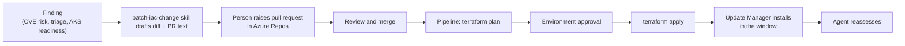

**What is in `patch-as-code/`**

| File | What it defines |
|---|---|
| `main.tf` | One Update Manager maintenance configuration and dynamic scope per patch group (machines tagged `patch-group = <key>`), plus one-off emergency windows that expire after a day |
| `variables.tf` | `patch_groups` (recurring windows, classifications, KB exclusions) and `emergency_windows` (KBs, start time, change reference, reason) |
| `patch-plan.auto.tfvars.example` | The patch plan the agent edits: a pilot and a production window, and a commented emergency example |
| `azure-pipelines.yml` | Sample Azure Pipelines definition: plan on merge, then apply after approval on the `patch-production` environment |

**Set it up**

1. Copy `patch-as-code/` into your infrastructure repository and rename the example to
   `patch-plan.auto.tfvars`. Add a remote backend in `versions.tf`.
2. Set each machine's patch orchestration to **Customer Managed Schedules** (`AutomaticByPlatform` with
   *bypass platform safety checks on user schedule*) and tag it `patch-group = pilot` or `prod`.
3. Create the pipeline from `azure-pipelines.yml`, with a workload identity service connection that can
   manage maintenance configurations. Add an **Approvals** check to the `patch-production` environment and
   branch policies (required reviewers) on `main`.
4. Set `PATCH_IAC_REPO` in `agent-config/parameters.json` and run the deploy script again. This loads the
   `patch-iac-change` skill and the sixth prompt.

**Use it**

Run `patch-6-iac-change` after a CVE risk review, or ask, for example, "Draft the Terraform change to patch
the KEV CVEs on prod before the SLA." The agent returns:

- the diff, for example a new `emergency_windows` entry with the KB numbers, start time and a change
  reference placeholder;
- the pull request description with the evidence, SLA due date and expected `terraform plan` result;
- the approvals needed.

A person raises the pull request; the pipeline does the rest after the approvals. For AKS, the same skill
drafts the change to `kubernetes_version`, node pool `orchestrator_version` or `node_os_upgrade_channel` in
the cluster's own Terraform.

> If you later connect the agent to Azure DevOps, it could raise the pull request itself. Keep the branch
> policies and environment approval so a person still approves every change.

## 11. Troubleshooting

| Symptom | Likely cause | Fix |
|---|---|---|
| `Deploy-AgentConfig.ps1` returns 401 or 403 | Caller has no admin role on the agent | Grant **SRE Agent Administrator** on the agent and run `az login` again |
| VMs show as "not assessed" or stale | Periodic assessment is off, or the VM is deallocated | Enable periodic assessment in Update Manager; start the VM or record an exception |
| AKS deprecated-API or PDB checks return `Unknown` | No in-cluster read | Enable Azure RBAC for Kubernetes and keep the `Azure Kubernetes Service RBAC Reader` assignment |
| EPSS or KEV fields are `Unknown` | Outbound access blocked | Allow the three CVE feed hosts, or accept `Unknown` |
| SLA verdicts look wrong | Synthetic demo policy still loaded | Replace the knowledge file and run the deploy script again |
| Scheduled task ran actions without asking | Autonomy set to Autonomous | Run `Deploy-AgentConfig.ps1 -Only ScheduledTasks -ReplaceScheduledTasks`, or edit the task and set **Autonomy** to **Review** |
| Skill not used | Prompt does not name it, or the description is vague | Name the skill in the prompt (`Use the patch-triage skill`) |
