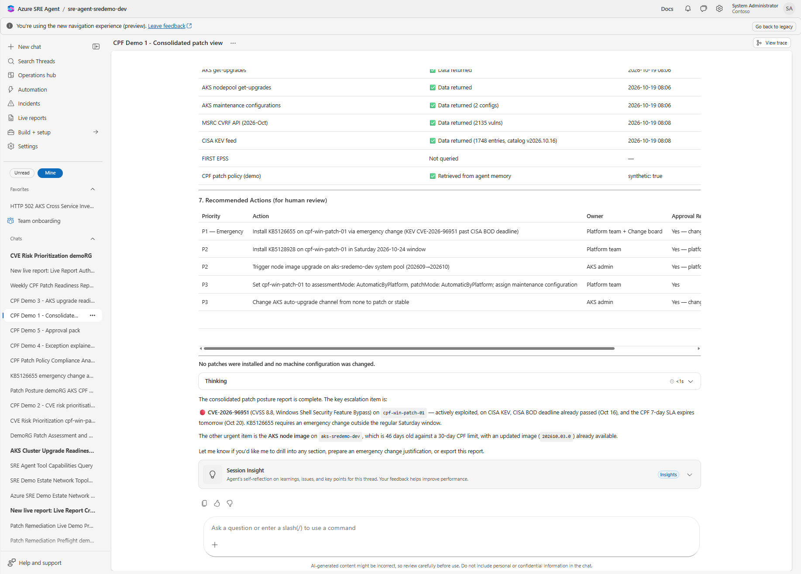
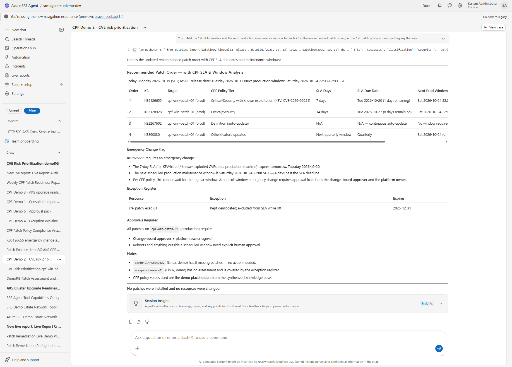
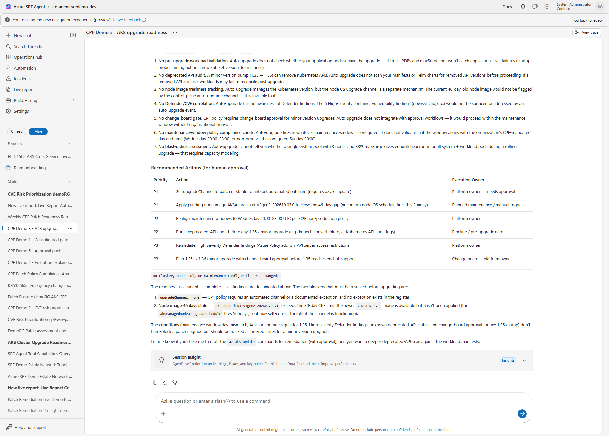
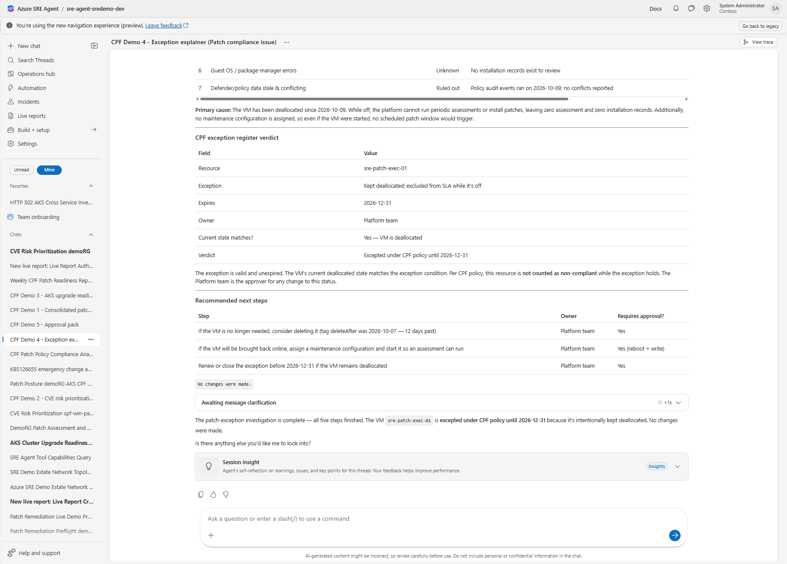
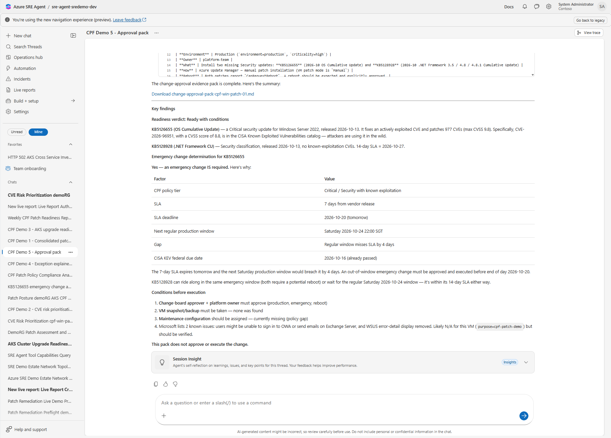
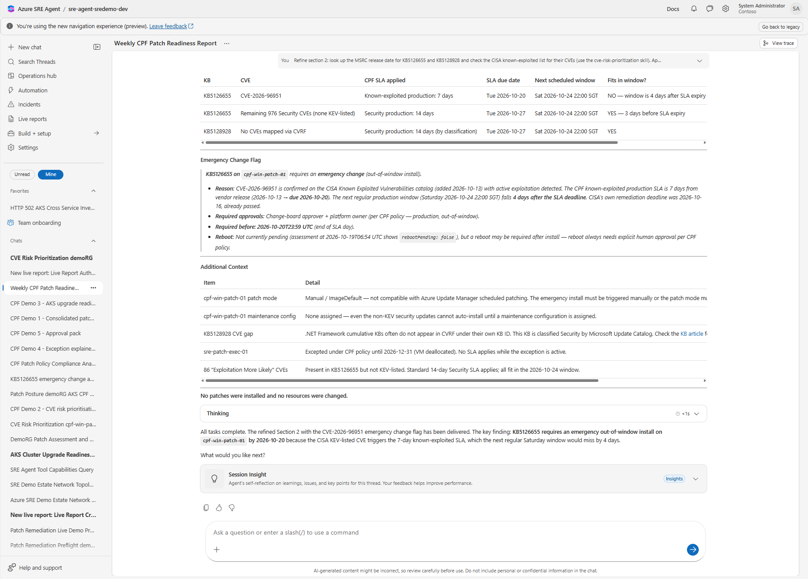

# Use cases: patch management with Azure SRE Agent

Each use case below is configured in `agent-config/` and was shown in the CPF POC. Use cases 1 to 6 are
**read only**: the agent finds, ranks, explains and documents. Installation stays with Azure Update Manager
and AKS, after human approval.

## Why an agent, when Azure already has native patch tools?

Azure Update Manager, AKS auto-upgrade and Defender for Cloud each do their own job well. The agent does
not replace them. It **reads across them** and does the analysis and paperwork that people do by hand today.

| Native tool gives you | Gap that remains | What the agent adds |
|---|---|---|
| Update Manager: missing updates per machine | No view across VMs, Arc servers **and** AKS together; no link to your SLA or exception register | One cited posture across all sources, compared with your policy |
| Defender for Cloud: CVEs and severity | No link from CVE to the KB that fixes it, to known exploitation (KEV, EPSS), or to your patch window | KB-to-CVE matrix ranked by real-world risk, with SLA due dates |
| AKS auto-upgrade and upgrade profile | Says *what* version is available, not whether the cluster is *ready* (deprecated APIs, PDBs, node pools, windows) | Readiness verdict with blockers and conditions |
| Compliance dashboards | Say *that* a machine is non-compliant, not *why* | Evidence timeline and cause (deallocated, wrong patch mode, stale assessment, excepted) |
| Change process | Engineers assemble CAB evidence by hand | Draft approval pack with risk, rollback and emergency-change decision |

## Use case catalogue

### 1. Consolidated patch posture

| | |
|---|---|
| Question | "What is our patch posture across VMs, Arc servers and AKS, against our policy?" |
| Skill / prompt | `patch-triage` / `prompts/patch-1-consolidated-view.md` |
| Sources | Update Manager assessments, Resource Graph, AKS upgrade profile, Defender for Cloud, policy knowledge |
| Output | Coverage summary, SLA status per machine, stale or unknown data, P1–P4 recommended actions, citations |
| Value | Replaces manual export-and-merge across several consoles; every fact has a source and UTC timestamp |

### 2. CVE risk prioritisation

| | |
|---|---|
| Question | "Which KB fixes which CVE, and which do we patch first?" |
| Skill / prompt | `cve-risk-prioritization` / `prompts/patch-5-cve-risk.md` |
| Sources | Update Manager, MSRC CVRF, FIRST EPSS, CISA KEV, Defender for Cloud, exposure (public IP, NSG) |
| Output | Executive summary, KB-to-CVE matrix, risk ranking chart, emergency-change flag, SLA due dates |
| Value | Turns "976 CVEs" into a short, defensible order of work tied to policy |

### 3. AKS upgrade readiness

| | |
|---|---|
| Question | "Is the cluster ready for its next control-plane and node-image upgrade?" |
| Skill / prompt | `aks-upgrade-readiness` / `prompts/patch-2-aks-readiness.md` |
| Sources | AKS upgrade profile, node pools, auto-upgrade channel, maintenance configuration, in-cluster read (deprecated APIs, PDBs) |
| Output | Ready / ready with conditions / not ready, blockers with evidence, what auto-upgrade alone would miss |
| Value | Avoids failed or disruptive upgrades; gives the platform team a checklist before the window |

### 4. Exception and non-compliance explainer

| | |
|---|---|
| Question | "Why is this server not showing as compliant?" |
| Skill / prompt | `patch-exception-explainer` / `prompts/patch-3-explain-exception.md` |
| Sources | Activity log, power state, assessment history, patch mode, maintenance configuration, exception register |
| Output | One-line answer, evidence timeline, cause table, exception register verdict, next steps |
| Value | Cuts investigation from hours to minutes; separates real gaps from approved exceptions |

### 5. Change-approval evidence pack

| | |
|---|---|
| Question | "Prepare the CAB pack for patching this VM." |
| Skill / prompt | `patch-approval-pack` / `prompts/patch-4-approval-pack.md` |
| Sources | Latest assessment, policy SLA and windows, KEV status, backup and maintenance configuration |
| Output | Readiness verdict, what / why / how / reboot, emergency-change decision, conditions, approvers. Never approves or executes. |
| Value | Consistent, complete change records; faster CAB decisions |

### 6. Weekly patch readiness report (scheduled)

| | |
|---|---|
| Trigger | Every Monday 09:00 SGT (`scheduled-tasks/weekly-patch-readiness-report.json`) |
| Skills | `patch-triage`, `aks-upgrade-readiness`, `patch-exception-explainer` |
| Output | Coverage, SLA breaches and items due in 7 days, AKS verdicts, top exceptions, missing data sources |
| Value | Proactive: the team starts the week with the list, instead of building it |

### 7. Gated remediation on a pilot VM (optional, write access)

| | |
|---|---|
| Question | "Install the approved Security updates on the pilot VM." |
| Skill | `patch-remediation` (loaded only with `-IncludeWriteSkills`), run by custom agent `patch-remediation-agent` |
| Requires | `enable_patch_write = true` scoped to one pilot resource group; Review mode; an approved change |
| Flow | Pre-checks, then human approval in chat, then Update Manager one-time install, then reassess and report |
| Value | Closes the loop on low-risk machines while keeping a human in control |

### 8. Patch change as code (example remediation step)

| | |
|---|---|
| Question | "Fix the KEV-listed CVEs before the SLA, through infrastructure as code." |
| Skill / prompt | `patch-iac-change` / `prompts/patch-6-iac-change.md` |
| Sources | Findings from use cases 1 to 3, machine tags and patch mode, deployed maintenance configurations, AKS available upgrades, policy |
| Output | A diff to `patch-as-code/patch-plan.auto.tfvars` (or the AKS Terraform), a pull request description with evidence, and the approvals needed. Read only. |
| Flow | Agent drafts, then a person raises the pull request in Azure Repos, then review and merge, then pipeline plan, then environment approval, then `terraform apply`. Update Manager installs in the window; the agent reassesses afterwards |
| Value | Every patch change is versioned, reviewed and repeatable; the agent needs no write access to Azure |

## What the agent does not do in this kit

- Install updates on production machines.
- Change patch orchestration modes, maintenance configurations or AKS auto-upgrade channels directly. It drafts
  those changes as code (use case 8); people merge and the pipeline applies them.
- Write to ITSM tools such as ServiceNow or Azure DevOps.
- Approve changes. The agent drafts; people approve.
